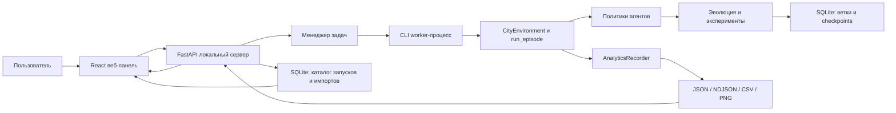

# CitySim — описание проекта

CitySim — исследовательская мультиагентная симуляция развития города. Несколько
застройщиков конкурируют за клетки карты, выбирают здания и управляют бюджетом;
их стратегии можно обучать нейроэволюцией, тестировать и сравнивать в локальной
веб-панели.

> **В этом документе:** [Обзор](#обзор)
> · [Архитектура](#архитектура)
> · [Данные](#данные-и-метрики)
> · [Запуск](#установка-и-запуск)
> · [Ограничения](#ограничения-и-известные-особенности)
> · [Roadmap](#предложения-roadmap)
> · [Руководство пользователя](USER_GUIDE.md)

## Обзор

Проект моделирует компромисс между доходностью застройщиков и качеством
городской среды. Агенты строят на двумерной сетке, оплачивают стоимость и
обслуживание, конкурируют за землю; жители выступают независимым оракулом для
оценки удобства города.

CitySim полезен для учебных и исследовательских экспериментов, изучения
мультиагентных стратегий и анализа повторяемых прогонов. Это симулятор и
инструмент экспериментов, а не готовая система городского планирования.

### Основные возможности

- **Симуляция:** несколько стратегий и агентов, аукцион за клетки, бюджет,
  прибыль, налоги/субсидии, требования к городу, внешние эффекты и шоки.
- **Обучение:** нейроэволюционная оптимизация популяции стратегий с
  контрольными точками и возобновлением.
- **Действия:** тип/качество строительства и обучаемые измерения этажности и
  качества озеленения крыши.
- **Эксперименты E1–E12:** кривые обучения, baseline-сравнения, внешние эффекты,
  требования, масштабирование агентов, обобщение, разнообразие, районы,
  зависимость от истории, регулирование, шоки и факторная абляция.
- **Веб-панель:** запуск задач, live-demo, история обучения, сравнение моделей,
  аналитика, экспорт и импорт архивов.
- **Воспроизводимость:** seeds, конфигурации, логи действий и раундов,
  SQLite-каталог и экспорт переносимых ZIP.

## Архитектура

### Компоненты и поток данных



### Слои

1. **Интерфейс:** React и TypeScript отображают форму запуска, текущую задачу,
   историю, аналитику, обмен архивами и живую карту. Общие клиентские модули
   нормализуют API-ошибки, доступные подтверждения/уведомления и локальные
   настройки браузера.
2. **API:** FastAPI валидирует запросы, формирует задачи и предоставляет данные
   интерфейсу. API и страница панели предназначены для локального доступа.
3. **Менеджер задач:** запускает отдельный Python-процесс для симуляции,
   обучения, эксперимента или сравнения; сохраняет логи и статус.
4. **Модель:** `CityEnvironment` хранит карту/экономические слои, `run_episode`
   задаёт цикл раундов, политики выбирают действия.
5. **Обучение и эксперименты:** эволюционный движок оценивает геномы; функции
   E1–E12 собирают сравнимые экспериментальные результаты.
6. **Хранение:** артефакты запуска пишутся в файлы; история и каталоги
   организованы в SQLite; перенос между компьютерами выполняется архивами.

### Жизненный цикл демо

1. Пользователь отправляет тип `demo`, стратегию, размер сетки, seed и число
   раундов.
2. FastAPI проверяет параметры и запускает worker с отдельной папкой артефактов.
3. `CityEnvironment` создаёт карту, агенты получают наблюдения и политики
   формируют действия; выполняются проверки бюджета и правил.
4. После действия записываются событие аналитики и сжатое состояние карты.
   В конце раунда записываются метрики города.
5. Веб-панель читает новые кадры и рисует изометрию в браузере.
6. По окончании сохраняются сводки, CSV/JSON и PNG; кадры можно просмотреть и
   отрендерить в PNG по запросу.

### Жизненный цикл обучения

1. Выбирается ветка истории, конфигурация города и параметры эволюции.
2. Популяция стратегий оценивается на наборе эпизодов и сидов.
3. Селекция и мутации создают следующее поколение; по заданному интервалу
   создаётся атомарный checkpoint полной популяции.
4. Прогресс и журналы доступны в панели; запрос остановки выполняется после
   текущего поколения и сохранения.
5. Для лучшей стратегии проводится финальная оценка и сохраняются метрики
   поколений и журналы оценки.

### Модель действий и экономики

Политика выбирает строительное действие факторизованно: место, тип здания,
качество, этажность и озеленение крыши имеют отдельные компоненты выбора.
Ограничения этажности зависят от типа (жильё — 12, коммерция — 20, смешанное —
12, промышленность — 8, зелёная зона — 3); крыша имеет 4 уровня озеленения.

Экономика учитывает затраты, доход, обслуживание, локальное насыщение, глобальные
балансы, загрязнение/шум, стоимость земли, жителей и регулирование. Районная
синергия зависит от сочетания функций района и доли озеленения; её состояние
обновляется между раундами. Модель формул и протокольных параметров приведена
в [MODEL.md](MODEL.md).

**Greedy baseline:** решение Greedy и его таблица прогнозируемого дохода
оставлены прежними; политика использует нейтральные значения этажности и крыши.
Районная синергия может менять фактическую экономику мира, но Greedy не
прогнозирует накопленный районный бонус. Поэтому результат сравнения нужно
интерпретировать как сравнение исходной жадной стратегии с расширенной средой,
а не как две политики с одинаковым прогнозным знанием.

## Технологический стек

| Область | Технологии |
|---|---|
| Язык и модель | Python 3.13+, NumPy |
| Ускорение вычислений | Numba |
| Сервер | FastAPI, Uvicorn, Pydantic |
| Хранение | SQLite, JSON, NDJSON, CSV, ZIP |
| Визуализация результатов | Matplotlib, ECharts |
| Веб-клиент | React 19, TypeScript, Vite |
| Демо на рабочем столе | Pygame (опциональный интерактивный режим CLI) |
| Тесты | `unittest`-совместимые тесты в `tests/` |

Зависимости Python перечислены в `requirements.txt` и `pyproject.toml`.
Сборка веб-клиента включена в `citysim/web/build`; для обычного запуска Node.js
не требуется. Node.js/npm нужны для разработки и пересборки интерфейса.

## Структура проекта

```text
citysim/
  analytics.py               запись и чтение аналитики
  cli.py                     команды `python -m citysim`
  config.py                  конфигурации и константы модели
  dashboard.py               локальное FastAPI-приложение и worker-менеджер
  dashboard_worker.py        обработка фонового сравнения моделей
  episode.py                 выполнение раунда/эпизода, расчёт fitness
  evolution.py               популяционная эволюция и оценка стратегий
  experiment_store.py        каталог запусков, импорт/экспорт ZIP
  experiments*.py            эксперименты E1–E12
  live_demo.py                запись/декодирование состояния карты
  metrics.py                  метрики карты и пространственного распределения
  policy.py                   нейросетевая и базовые политики
  training_history.py         ветки и снимки обучения в SQLite
  visualizer.py, plotting.py   Pygame и статическая визуализация
  web/                        HTML и собранный веб-интерфейс
webapp/
  src/                        React/TypeScript исходники, API/feedback helpers, CSS, аналитика
docs/
  USER_GUIDE.md               пользовательское руководство
  PROJECT.md                  описание проекта
  MODEL.md                    формулы и протокол модели
tests/                        unit- и интеграционные тесты
runs/                         локальные артефакты, база истории и данные
```

### Ключевые файлы по назначению

| Задача | Файлы |
|---|---|
| Параметры модели и сети | `citysim/config.py`, `citysim/policy.py` |
| Экономика, карта и наблюдения | `citysim/world.py`, `citysim/grid.py`, `citysim/citizens.py` |
| Эпизоды и fitness | `citysim/episode.py`, `citysim/metrics.py` |
| Обучение и checkpoints | `citysim/evolution.py`, `citysim/training_history.py`, `citysim/checkpoint_io.py` |
| CLI и сценарии | `citysim/cli.py`, `citysim/experiments_learning.py`, `citysim/experiments_sweeps.py`, `citysim/experiments_robustness.py`, `citysim/experiments_actions.py` |
| Веб API и очередь задач | `citysim/dashboard.py`, `citysim/dashboard_worker.py` |
| Аналитика и обмен файлами | `citysim/analytics.py`, `citysim/experiment_store.py` |
| Клиентский интерфейс | `webapp/src/App.tsx`, `webapp/src/AnalyticsPage.tsx`, `webapp/src/styles.css`, `webapp/src/theme.css` |
| Общие UI-состояния | `webapp/src/api.ts`, `webapp/src/Feedback.tsx`, `webapp/src/useStoredState.ts` |
| Формулы и проверки | `docs/MODEL.md`, `tests/` |

Настройки формы запуска и фильтры аналитики сохраняются только в `localStorage`
текущего браузера и не попадают в экспортируемые ZIP. Файлы пользователя и
содержимое архивов в browser storage не сохраняются.

## Данные и метрики

### Что записывается

| Данные | Примеры полей | Зачем |
|---|---|---|
| Параметры запуска | Тип задачи, seed, конфигурация города и обучения | Повторить запуск и объяснить различия |
| События действий | Раунд, агент, исход, клетка, тип/качество, этажность, крыша, стоимость, ставка, ущерб | Изучать поведение стратегий и причины успеха/отказа |
| Состояние агента | Бюджет, прибыль, банкротство | Анализировать индивидуальные результаты |
| Метрики раундов | Заполненность, качество, зелёная доля, удовлетворённость, население, рабочие места, товары, загрузка, ущерб, налоги/субсидии | Следить за динамикой города |
| Итоговые метрики | Показатели города и агентов, scores, breakdown fitness, шоки | Сравнивать итог эпизода |
| Динамика обучения | Fitness лучшего/среднего, поколение и метаданные | Оценивать ход эволюции |
| Состояния live-demo | Слои карты, типы, качество, этажность, крыши, владелец | Восстановить кадр без сохранения PNG на каждый ход |

Статистики по метрикам включают среднее, медиану, min/max, стандартное
отклонение, перцентили 10/25/75/90 и линейный тренд по раундам, если для
метрики есть числовые точки.

### Показатели, отображаемые в аналитике

- качество города и средняя удовлетворённость жителей;
- зелёная доля, число застроенных клеток и разнообразие типов застройки;
- население, загрузка и баланс товаров;
- нарушения, внешний ущерб, прибыль и средний fitness;
- число и типы действий, распределение по агентам/раундам;
- этажность, озеленение крыш, стоимость строительства, ставки и ущерб;
- метрики поколений обучения и профиль качества города.

Fitness — составная целевая оценка, включающая нормализованную прибыль,
строительную активность, городское благополучие, штрафы за нарушения,
экстерналии, пропуски и банкротство. Точные веса находятся в `config.py` и
формально описаны в `MODEL.md`.

### Форматы и расположение

Для dashboard-запуска типичные файлы находятся в `runs/train/.dashboard/jobs/<id>/artifacts/`:

| Файл | Содержимое |
|---|---|
| `actions.ndjson` | По одной записи JSON на действие |
| `rounds.ndjson` | По одной записи JSON на раунд |
| `analytics_summary.json` | Итоги, агрегаты, конфигурация и счётчики действий |
| `training_metrics.json` | Динамика и сводки обучения |
| `frames.jsonl` | Состояния живой карты, сжатые отдельно по слоям |
| `training.log` | Консольный вывод задачи (рядом с `artifacts`, в папке job) |

Расположение меняется параметром `--out`. История по умолчанию хранится в
`runs/.citysim-history`; каталог импортированных наборов и каталог запусков
панели — под `<out>/.dashboard/store`. SQLite содержит индекс/метаданные, а
файлы результатов хранятся отдельно. Папка `runs/` является локальной и не
предназначена для коммита.

Каталог истории дополнительно индексирует отдельные геномы из checkpoint и
сохраняет импортированные/клонированные векторы как content-addressed `.npy`
объекты. Метаданные геномов и состояние корзины находятся в SQLite. Удаление
веток, геномов, запусков и наборов по умолчанию мягкое; восстановление возможно
до окончательной очистки. Ветки линейны: поддерживаются создание от снимка,
сравнение и fast-forward, но не смешивание весов или история с несколькими
родителями. Экспорт одного генома — NPZ с JSON-метаданными, параметрами
архитектуры и вектором; импорт проверяет формат и ожидаемый размер генома.

## Визуализации панели

Панель группирует визуализации по смыслу:

1. **Сводка:** KPI-карточки, sparkline и тренд выбранных метрик.
2. **Динамика:** линия метрики по раундам и кривая fitness по поколениям.
3. **Сравнение:** сгруппированные KPI и многомерный radar-профиль.
4. **Поведение:** донат по действиям, тепловая карта агент/раунд.
5. **Распределения:** гистограммы ставок/стоимости и box plot.
6. **Факторы строительства:** распределения этажности и качества крыши.
7. **Взаимосвязи:** scatter-график ставок и внешнего ущерба с коэффициентом
   корреляции Пирсона.

Графики строятся только при наличии соответствующих данных; для пустых или
старых запусков интерфейс показывает, что данных недостаточно. Действия в
аналитике можно ограничить агентом и диапазоном раундов; одновременно
сравниваются не более четырёх источников.

## Установка и запуск

### Веб-панель

```powershell
python -m venv .venv
.\.venv\Scripts\Activate.ps1
pip install -r requirements.txt
.\.venv\Scripts\python.exe -m citysim dashboard
```

Дополнительные параметры: `--port 8766`, `--no-browser`, `--out runs/train`,
`--history-dir runs/.citysim-history`. Хост ограничен `127.0.0.1`; внешний
сетевой доступ намеренно не предоставляется.

### CLI: симуляция, обучение, эксперимент

```powershell
# Одно быстрое демо с жадной политикой и 12 раундами
.\.venv\Scripts\python.exe -m citysim demo --quick --policy greedy --seed 42 --grid 12x12 --n-agents 8 --actions 12 --out runs/demo

# Короткое обучающее smoke-тестирование
.\.venv\Scripts\python.exe -m citysim train --quick --out runs/train_quick

# E12 с заданными сидами
.\.venv\Scripts\python.exe -m citysim experiment e12 --quick --seeds 0-2 --out runs/e12_quick

# Список команд и опций
.\.venv\Scripts\python.exe -m citysim --help
.\.venv\Scripts\python.exe -m citysim train --help
```

В CLI длина эпизода передаётся через `--actions` (число раундов на
эпизод); число последовательных действий агента за раунд задаётся через
`--actions-per-round` (от 1 до 4, по умолчанию 2). Размер карты задаётся
через `--grid` и ограничен сторонами от 3 до 64 клеток.
`--generations` задаёт число поколений обучения, а `--episodes` — число эпизодов
оценивания на поколение.

### Продолжение обучения и ветки

```powershell
.\.venv\Scripts\python.exe -m citysim history branches
.\.venv\Scripts\python.exe -m citysim history log --branch main
.\.venv\Scripts\python.exe -m citysim history branch-create trial --from main@40
.\.venv\Scripts\python.exe -m citysim train --branch trial --resume --generations 200 --out runs/train_trial
```

Снимки сохраняются каждые 10 поколений по умолчанию. Для более частого
сохранения укажите `--checkpoint-every 1`. Возобновляйте обучение в той же
истории и с совместимыми параметрами архитектуры/популяции.

### Разработка frontend

```powershell
npm install --prefix webapp
npm run build --prefix webapp
```

Результат сборки помещается в `citysim/web/build`. Для изменения интерфейса
редактируйте исходники в `webapp/src/`; обычному пользователю Node.js не нужен.
Frontend build запускает TypeScript-проверку и сборку Vite. Веб-клиент
использует существующие React/CSS APIs; отдельный test runner для frontend
пока не настроен.

## Эксперименты E1–E12

| Код | Исследовательский вопрос |
|---|---|
| E1 | Как меняется результат по мере обучения? |
| E2 | Как нейроэволюционная политика сравнивается с базовыми стратегиями? |
| E3 | Как влияют внешние эффекты? |
| E4 | Как меняются результаты при разных требованиях к городу? |
| E5 | Как масштабирование числа агентов влияет на систему? |
| E6 | Переносится ли стратегия на новые условия? |
| E7 | Насколько разнообразны найденные решения? |
| E8 | Как влияет районная структура? |
| E9 | Насколько результат зависит от порядка/истории развития? |
| E10 | Как влияет регулирование — налоги и субсидии? |
| E11 | Как агенты и город реагируют на шоки? |
| E12 | Как факторизованные действия и районная синергия влияют на результат по отдельности и вместе? |

E12 использует 2×2 факторный дизайн: старое/расширенное пространство действий
пересекается с выключенной/включённой синергией. Четыре нейросетевых условия
обучаются на общих сидах; неизменённый Greedy оценивается как внешний baseline
в расширенной экономике.

## Ограничения и известные особенности

- **Локальный сервер:** панель слушает только `127.0.0.1`, а не является
  многопользовательским сетевым сервисом.
- **Одна активная задача:** одновременно запускается только одна задача
  dashboard-процесса.
- **Остановка обучения отложенная:** завершает текущее поколение и сохраняет
  checkpoint; паузы обучения нет.
- **Архивы не объединяют ветки:** импортированный набор можно изучать отдельно;
  полный архив можно переключить в активную историю, но автоматического
  слияния веток нет.
- **Старые журналы могут быть неполными:** подробная аналитика появляется там,
  где есть `actions.ndjson` и `rounds.ndjson`.
- **Миграции геномов не гарантируются:** несовместимые размер/схема checkpoint
  требуют нового обучения.
- **Рост диска:** полная история популяций и длинные журналы занимают заметное
  место. Проверьте объём перед экспортом полного ZIP.
- **Пределы импорта:** ZIP до 20 ГиБ, распакованное содержимое до 50 ГиБ;
  архив проверяется перед добавлением.
- **Оценка не тождественна городской политике:** fitness — исследовательская
  целевая функция; сравнивайте также городские KPI и поведение.
- **Проверка воспроизводимости:** используйте одинаковые параметры и seeds.
  Параллельное исполнение/оборудование может влиять на время выполнения.

## Предложения roadmap

Это идеи для дальнейшей разработки, а не обещанные или уже реализованные функции.

1. **Пакетная очередь:** запуск нескольких конфигураций/seed с отчётом по пакету.
2. **Более удобные протоколы экспериментов:** сохранённые шаблоны, сравнение
   конфигураций и валидатор воспроизводимости.
3. **Интеграция архивов:** индексировать метаданные ZIP и упростить групповую
   выгрузку между машинами.
4. **Дополнительная статистика:** интервалы неопределённости и сравнение
   распределений результатов по нескольким seed на аналитической странице.
5. **Экспорт отчёта:** единый HTML/PDF с графиками, конфигурацией и методикой.
6. **Управление ресурсами:** оценка объёма хранилища, ограничение workers и
   предварительная оценка времени по предыдущим прогонам.
7. **Документационный сайт:** Material for MkDocs с автоматической сборкой,
   поиском и публикацией версионированных руководств.

## Визуальный стиль документации

Для сайта документации рекомендуется палитра «лабораторная, но читаемая»:
графитовый фон `#0B1013`, поверхность `#141C21`, текст `#E7EAF0`, вторичный
текст `#A9B2C1`, фиолетовый акцент `#8B5CF6`, коралловый `#E55137`,
оранжевый `#FF4F00`. Подсказки — голубые `#8BB8FF`, предупреждения — янтарные
`#FFB454`, ошибки — коралловые, подтверждения — бирюзовые `#63C7A5`.

Заголовки — Inter/системный sans-serif, команды и имена файлов — IBM Plex Mono.
Карточки с тонкой границей и умеренной тенью помогают разделять темы; callout
блоки должны различаться не только цветом, но и иконкой/заголовком, чтобы
сохранять доступность. Скриншоты следует брать из актуального интерфейса и
обрамлять подписью, описывающей задачу, а не только внешний вид.
