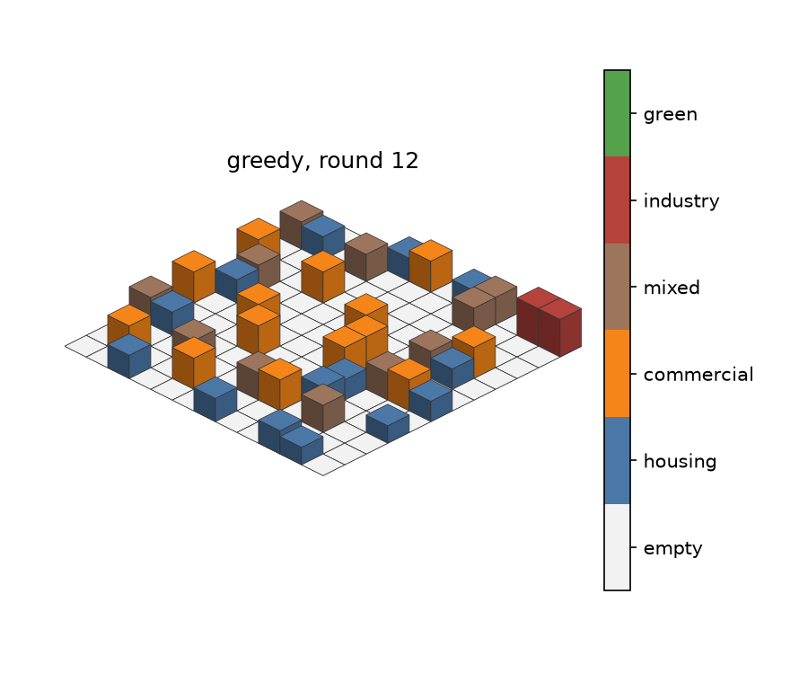

# CitySim — руководство пользователя

CitySim помогает запускать городские симуляции, обучать стратегии застройщиков
и сравнивать результаты. Это руководство проведёт от первого запуска до экспорта
данных; для знакомства с интерфейсом достаточно первых пяти минут.

> **В этом руководстве:** [Быстрый старт](#быстрый-старт-за-5-минут)
> · [Возможности](#возможности)
> · [Рецепты](#сценарии-работы)
> · [Интерфейс](#карта-интерфейса)
> · [FAQ](#частые-вопросы)
> · [Глоссарий](#глоссарий)
> · [Техническое описание проекта](PROJECT.md)

## Быстрый старт за 5 минут

Кратко: веб-панель, симуляция, обучение и результаты работают локально на вашем
компьютере. За пять минут вы установите зависимости и проведёте первый запуск.

### 1. Подготовьте окружение

Коротко: создайте отдельное Python-окружение и установите зависимости проекта.

Нужен Python 3.13 или новее. В PowerShell из корневой папки проекта выполните:

```powershell
python -m venv .venv
.\.venv\Scripts\Activate.ps1
pip install -r requirements.txt
```

Если политика PowerShell не разрешает активацию виртуального окружения,
пропустите команду `Activate.ps1` и используйте исполняемый файл напрямую:

```powershell
.\.venv\Scripts\python.exe -m pip install -r requirements.txt
```

### 2. Запустите панель

Коротко: запустите локальный сервер CitySim; адрес появится в терминале.

```powershell
.\.venv\Scripts\python.exe -m citysim dashboard
```

Панель обычно открывается автоматически. Если этого не произошло, откройте
адрес, указанный в терминале; стандартный адрес — `http://127.0.0.1:8765`.

> ⚠️ **Важно:** сервер принимает подключения только с этого компьютера. Чтобы
> перенести результаты на другой компьютер, используйте ZIP-экспорт и импорт
> на странице **«Данные»**.

### 3. Запустите первое демо

Коротко: выберите стратегию и параметры эпизода, затем откройте живую карту.

1. Откройте **«Запуски»** и выберите карточку **«Демо»**.
2. Оставьте стратегию **«Жадная»**, сетку `12x12` и быстрый режим.
3. Установите нужное количество раундов — по умолчанию быстрый режим использует
   6, обычный 20.
4. Нажмите **«Запустить задачу»**.
5. Откройте страницу **«Живая симуляция»**: город обновляется по мере ходов.
   Можно поставить демо на паузу, изменить скорость и скачать PNG выбранного
   кадра.

### 4. Посмотрите результат

Коротко: используйте аналитику, чтобы изучить показатели и динамику только что
завершённого запуска.

После демо перейдите в **«Аналитика»**. Там доступны итоговые показатели,
динамика по раундам и распределение действий. Первый запуск создаёт каталог
результатов автоматически.



*Иллюстрация создана реальным прогоном: стратегия Greedy, seed 42, сетка 12×12,
8 агентов, 12 раундов. В этом примере построено 41 здание; качество города —
0,545, удовлетворённость — 0,631, средняя загрузка — 0,802. Это рендер карты,
а не снимок интерфейса.*

Для callout-блоков используйте текстовые подписи вместе с иконками:

> 💡 **Совет:** для сравнения стратегий используйте одинаковые тестовые сиды.

> ⚠️ **Важно:** полный архив контрольных точек может быть большим.

> ❌ **Проблема:** кнопка запуска недоступна.
> ✅ **Решение:** проверьте сообщения валидации, число агентов, размер популяции
> и наличие подходящего checkpoint.*

**Место для снимка интерфейса:** после шага 3 вставьте скриншот формы демо с
выбранной стратегией, сеткой и раундами.

## Возможности

Кратко: в панели можно настраивать эпизоды, обучать стратегии, смотреть город и
сопоставлять сохранённые результаты.

### Настройка симуляции

Кратко: параметры определяют размер и длительность эпизода, число участников и
режим моделирования.

В форме запуска выберите тип задачи и подходящие параметры. Демо запускает один
эпизод; обучение эволюционирует популяцию стратегий; эксперимент выполняет
заранее заданный научный сценарий.

| Параметр | Что меняет | Замечания |
|---|---|---|
| Раундов на эпизод | Длину одного прогона симуляции | Допустимо 1–10 000; быстрый/обычный режим задаёт значение по умолчанию 6/20 |
| Размер сетки | Высоту и ширину карты, например `12x12` | В модели размер каждой стороны должен быть не меньше 3 |
| Стратегия | Правило выбора действий в демо | Ручная, случайная, жадная или обученная нейросеть |
| Агентов в городе | Число конкурирующих застройщиков | Больше агентов увеличивает нагрузку |
| Поколений | Число шагов эволюции стратегии | Относится к обучению и экспериментам, не к длине демо |
| Эпизодов на поколение | Сколько оценочных эпизодов проходит популяция за поколение | Увеличение обычно стабилизирует оценку, но удлиняет обучение |
| Размер популяции | Число стратегий в эволюционной популяции | В интерфейсе должен делиться на 4 и быть не меньше числа агентов; число эпизодов должно покрывать популяцию с учётом доли лиги |
| Сиды | Начальные значения генератора случайности | Для эксперимента можно задать список (`0,2,4`) или диапазон (`0-5`) |
| CPU workers | Число параллельных процессов | Пустое поле — автоматический выбор |
| Сценарий шока | Изменение условий в демо | Удаление промышленности, рост населения или землетрясение |

Быстрый режим меняет базовую конфигурацию города и обучения. Значение,
введённое вручную в поле раундов, передаётся явно и применяется независимо
от быстрого режима. Раунды задаются и для обучения: это длина эпизодов, на
которых оцениваются стратегии.

В обучении по умолчанию 80% мест эпизода занимают стратегии текущей
популяции (`--league-fraction 0.8` в CLI). Остальные места занимают оппоненты
Random, Greedy, Manual и нейросети Hall of Fame. Hall of Fame обновляется
каждые пять поколений и хранит до десяти лучших уникальных геномов. В отбор
попадают только фокусные стратегии, поэтому число эпизодов должно покрывать
популяцию: `эпизодов × фокусных_агентов ≥ размер популяции`. При двух агентах
и доле 0.8 фокусное место одно, поэтому популяции из 32 стратегий нужно
минимум 32 эпизода на поколение. Если `--episodes` не задан, CLI поднимает
его до минимума; в панели слишком маленькое значение блокирует запуск.

**Как настроить:**

1. Откройте **«Запуски»** и выберите **«Демо»**, **«Обучение»** или
   **«Эксперимент»**.
2. Заполните появившиеся поля. Для экспериментов задайте сиды; для обучения
   выберите ветку истории и укажите, нужно ли продолжить её.
3. Проверьте подсказки под формой. Если параметры несовместимы, кнопка запуска
   будет недоступна.
4. Нажмите **«Запустить задачу»**.

**Ограничения:** одновременно выполняется одна задача панели. Политика
«Нейросеть» доступна в демо, только если в истории есть сохранённый checkpoint.
Ветка с сохранённым обучением требует продолжения или создания новой ветки.

Форма запуска сохраняет выбранные параметры в локальном хранилище этого
браузера. Это не синхронизация между компьютерами и не сохранение файлов;
кнопка **«Сбросить параметры»** возвращает значения по умолчанию.

### Запуск и управление задачами

Кратко: панель показывает состояние задачи и доступные для её типа управляющие
действия.

Статус текущей задачи отображается в общей панели над страницами. Обзор
обновляется автоматически; для обучения показываются текущая и целевая
генерации, этап, ETA (если доступен) и лучший fitness.

| Кнопка или состояние | Действие |
|---|---|
| **Запустить задачу** | Создаёт демо, обучение или эксперимент |
| **Пауза** / **Продолжить** | Приостанавливает только живое демо |
| **Скорость** | Меняет задержку между действиями демо; 0 мс — максимально быстро |
| **Остановить симуляцию** | Останавливает демо |
| **Остановить после поколения** | Просит остановить обучение после завершения поколения и сохранения checkpoint |
| **Показать журнал ошибки** | Показывает последние сообщения процесса после сбоя |

Остановка обучения не является мгновенной: текущая генерация завершается, затем
сохраняется состояние. После этого можно продолжить запуск с теми же
параметрами. Пауза обучения в веб-интерфейсе не предусмотрена.

Состояния задачи: **выполняется**, **остановка**, **завершена**, **остановлена**,
**ошибка**. Если задача завершилась ошибкой, откройте журнал в панели задачи.

### Живая симуляция

Кратко: наблюдайте за развитием города в браузере, меняйте темп и сохраняйте
нужный кадр.

Страница **«Живая симуляция»** появляется для демо и показывает карту в
изометрии. Цвет фасада помогает различить тип здания, высота показывает
этажность, мягкая подсветка крыши — её качество, а светящийся маркер — агента.

1. Запустите демо.
2. Перейдите на страницу симуляции через кнопку **«Открыть симуляцию»** или
   автоматически после запуска.
3. Управляйте паузой и скоростью; последние действия и состояние города
   отображаются рядом с картой.
4. Наведите курсор на клетку для краткой подсказки; нажмите, чтобы закрепить
   сведения о здании, этаже, качестве крыши и агенте. Клавиатурой можно перейти
   к карте, перемещать подсветку стрелками, открыть сведения клавишей Enter и
   закрыть их клавишей Escape.
5. После окончания используйте ползунок истории кадров, чтобы выбрать ход.
6. Нажмите **«Скачать PNG»**, чтобы отрендерить и скачать выбранное состояние.

Состояния карты сохраняются как сжатые данные, а не как серия PNG. Картинка
генерируется только по запросу. История кадров входит в полный архив запуска.

### Аналитика и сравнение

Кратко: фильтры и графики помогают объяснить разницу между запусками, а не
только увидеть итоговую цифру.

На странице **«Аналитика»** можно выбрать до четырёх запусков или импортированных
наборов. Поддерживаются фильтры по агенту и диапазону раундов.

| Визуализация | Что помогает увидеть |
|---|---|
| KPI-карточки и sparkline | Итоговое качество, удовлетворённость, число действий и средний fitness; мини-график показывает изменение по раундам |
| Линии по раундам | Изменение выбранной метрики и отличия между запусками |
| Сравнение KPI | Сопоставление качества, удовлетворённости и зелёных зон |
| Донат действий | Доли типов действий, пропусков и сносов |
| Тепловая карта | Активность агентов по раундам |
| Scatter-график | Связь между ставками и внешним ущербом; отображается корреляция Пирсона |
| Гистограмма | Распределение стоимостей действий и ставок |
| Этажность и зелёные крыши | Распределение новых параметров строительства |
| Box plot | Разброс выбранной метрики между прогонами |
| Radar chart | Многомерный профиль города |
| Кривая обучения | Лучший результат, лучший за поколение и средний fitness по поколениям |

В обучающихся задачах аналитика обновляется автоматически, но набор доступных
графиков зависит от того, какие артефакты уже записаны. Для старых запусков
без подробных журналов доступны только сохранившиеся сводки.
Выбор прогонов, метрики, агента и диапазона раундов сохраняется в браузере.
Под заголовком показано время последнего успешного обновления; при ошибке
можно повторить загрузку, а на экране остаются последние успешные данные.
Изменения фильтров применяются после короткой паузы, чтобы не отправлять запрос
на каждый символ.

**Экспорт:** нажмите кнопку загрузки на карточке графика, чтобы сохранить PNG.
Для экспорта табличных данных выберите JSON или CSV в блоке выгрузки аналитики.
На странице **«Данные»** скачайте лёгкий или полный ZIP запуска.

### История обучения

Кратко: ветки и checkpoints сохраняют ход обучения и позволяют продолжить
эксперимент или сравнить модели.

История хранит ветки и неизменяемые снимки популяции с контрольными точками.
На странице **«История»** можно:

- просматривать снимки поколений выбранной ветки;
- создать ветку от другой ветки или ссылки вида `main@40`;
- сделать ветку активной для последующего обучения;
- переименовать или архивировать ветку, а также продвинуть её указатель
  вперёд до достижимого снимка;
- отправить ветку в корзину и восстановить её, пока она не удалена окончательно;
- переместить указатель ветки на ранее сохранённый снимок (это не удаляет более
  новые снимки);
- сравнить два снимка на общих тестовых сидах;
- проверить целостность хранилища и выполнить безопасную очистку после
  предпросмотра.

Сравнение снимков проверяет две модели в одинаковых условиях и показывает
метрики, интервалы доверия и разницу конфигураций. Очистка требует отдельного
подтверждения и отменяется, если история изменилась после предпросмотра.

### Каталог геномов и корзина

Кратко: каталог помогает найти и сравнить отдельные стратегии, а корзина защищает
от случайного удаления веток, геномов, запусков и импортированных наборов.

На странице **«Данные»**:

1. Найдите геном по имени, ветке или типу; откройте его, чтобы посмотреть
   происхождение и сводку параметров.
2. Отметьте один геном, чтобы экспортировать его как проверяемый `.npz`,
   клонировать или изменить имя. Отметьте два, чтобы сравнить векторы.
3. Выберите несколько геномов и нажмите **«В корзину»** для группового удаления.
4. Для переноса генома загрузите файл CitySim NPZ. Интерфейс проверит формат,
   архитектуру, количество параметров и числовые значения до сохранения.
5. Запуски и наборы удаляются кнопкой **«В корзину»** рядом с объектом.
   Активный набор и выполняющийся запуск удалить нельзя.
6. Внизу страницы **«Данные»** или **«История»** найдите объект в корзине.
   Восстановление можно отменить; **«Удалить навсегда»** требует отдельного
   подтверждения и уже необратимо.

> ⚠️ **Важно:** очистка контрольных точек — отдельная операция. Сначала откройте
> предпросмотр GC и убедитесь, что снимок не нужен ни одной ветке.

### Перенос результатов между компьютерами

Кратко: ZIP-архивы позволяют собрать данные с нескольких локальных установок
без сетевого подключения к чужим компьютерам.

Панель не подключается напрямую к другим компьютерам. Каждый компьютер
экспортирует результаты в ZIP; затем ZIP загружается на компьютере, где вы
собираете аналитику.

1. На исходном компьютере откройте **«Данные»**.
2. В таблице запусков выберите **«Лёгкий ZIP»** или **«Полный ZIP»**.
3. Перенесите архив удобным вам способом.
4. На целевом компьютере откройте **«Данные»**, выберите архив через поле файла
   или перетащите ZIP в область загрузки. Индикатор показывает передачу файла;
   после передачи сервер отдельно проверяет содержимое.
5. Проверьте сводку и разрешите конфликт имени: пропустить, переименовать или
   заменить набор.
6. Откройте **«Аналитика»** и отметьте импортированный набор для сравнения.

До завершения передачи её можно остановить кнопкой **«Отменить загрузку»**.
Отмена не добавляет набор в коллекцию; подтверждение импорта выполняется
отдельно после проверки архива.

После перемещения объекта в корзину можно сразу нажать **«Восстановить»** в
коротком уведомлении либо восстановить его позже на странице корзины. Операция
**«Удалить навсегда»** необратима и требует отдельного подтверждения. Подтверждения
и ввод новых имён открываются в диалогах интерфейса; Escape или кнопка отмены
закрывают диалог без выполнения операции.

| Архив | Содержимое | Для чего подходит |
|---|---|---|
| Лёгкий | Результаты, параметры, сводки, графики и файлы аналитики | Объединить результаты и построить сравнение |
| Полный | Содержимое лёгкого архива, история обучения и контрольные точки | Продолжить обучение из импортированной истории |

Импортированные наборы не сливают свои ветки с локальной историей. Полный набор
можно открыть как активную историю, а затем вернуться к локальной кнопкой
**«Вернуться к локальной истории»**. Предварительная проверка ZIP ограничивает
размер загрузки 20 ГиБ и распаковку 50 ГиБ.

## Сценарии работы

Кратко: рецепты ниже показывают типовой порядок действий для сравнения,
обучения, объединения данных и подготовки отчёта.

### Сравнить 100 и 500 раундов

Кратко: сравнивайте два запуска, меняя только длину эпизода.

1. Запустите демо с одинаковой стратегией, размером сетки, числом агентов и
   сидом; задайте 100 раундов.
2. Повторите запуск с теми же параметрами, изменив только раунды на 500.
3. В **«Аналитике»** выберите оба запуска.
4. Сравните итоговые KPI и динамику. Экспортируйте график в PNG при необходимости.

Чтобы сравнение было честным, меняйте за раз только интересующий параметр.
Для проверки обученной стратегии вместо демо запустите подходящий эксперимент
на одинаковых сидах.

### Найти сильную стратегию

Кратко: обучите стратегию, проверьте её на сохранённом снимке и сопоставьте с
базовыми вариантами.

1. В **«Запусках»** выберите **«Обучение»** и пустую ветку (или создайте новую
   на странице истории).
2. Задайте число поколений, эпизодов на поколение, размер популяции и сид.
3. Запустите обучение и следите за лучшим fitness и динамикой поколений.
4. После завершения посмотрите **«Аналитику»** и зафиксируйте ветку/поколение.
5. Запустите демо с политикой **«Нейросеть»**, выбрав сохранённый checkpoint.
6. Для сравнения моделей используйте одинаковые тестовые сиды на странице
   **«История»**.

Fitness — целевая оценка обучения, а не универсальная оценка «лучшего города».
Проверяйте также удовлетворённость, качество города, прибыль, ущерб и
банкротства.

### Собрать результаты с нескольких машин

Кратко: экспортируйте каждый прогон на его компьютере, затем импортируйте все
архивы в одну панель.

1. На каждом компьютере сохраните запуск завершённым.
2. Скачайте лёгкий ZIP, если нужны сравнение и аналитика; полный ZIP — если
   необходимо продолжить обучение.
3. На главной машине импортируйте архивы, задавая понятные имена, например
   `seed-02-cpu` и `seed-02-gpu`.
4. Выберите до четырёх источников на странице **«Аналитика»**.
5. Сравните общие метрики и выгрузите графики/данные.

Для корректного сравнения запишите конфигурацию и seed каждого прогона.
Различие компьютеров само по себе не гарантирует одинаковых условий запуска.

### Подготовить отчёт

Кратко: выгрузите отфильтрованные таблицы и графики вместе с параметрами запуска.

1. Выберите один или несколько запусков на странице аналитики.
2. Установите фильтр раундов и, если нужно, конкретного агента.
3. Скачайте нужные графики по одному в PNG.
4. Экспортируйте данные аналитики в CSV/JSON.
5. Сохраните лёгкий ZIP как воспроизводимый пакет результатов; полный архив
   добавляйте, если отчёт должен позволять продолжить обучение.

## Карта интерфейса

Кратко: основные разделы соответствуют шагам работы — от запуска через
наблюдение и анализ к хранению и обмену результатами.

| Раздел | Что находится внутри |
|---|---|
| **Обзор** | Количество локальных запусков и импортированных наборов, активная задача и последние запуски |
| **Запуски** | Настройка демо, обучения или E1–E12 |
| **Аналитика** | Фильтры, KPI, диаграммы и экспорт аналитики |
| **История** | Ветки, checkpoints, сравнение моделей и обслуживание хранилища |
| **Данные** | ZIP-экспорт и импорт, коллекция наборов |
| **Живая симуляция** | Изометрическая карта и управление текущим демо; доступна при запуске демо |
| Панель задачи | Статус, прогресс, остановка, переход к живому демо и журнал ошибок |

**Места для снимков интерфейса:**

1. **Форма запуска** — тип задачи, сетка, число раундов и подсказка быстрого режима.
2. **Панель задачи** — прогресс обучения, ETA, лучший fitness и кнопка остановки.
3. **Живая симуляция** — изометрическая карта, действия, пауза, скорость и PNG.
4. **Аналитика** — фильтр двух прогонов, KPI и линии по раундам.
5. **История** — выбор двух снимков и результат сравнения.
6. **Импорт ZIP** — предпросмотр архива и разрешение конфликта набора.

Для актуальных скриншотов запустите панель и сделайте снимки описанных экранов.
Иллюстрация в разделе быстрого старта — реальный рендер карты; она не заменяет
скриншоты UI.

## Частые вопросы

Кратко: здесь собраны решения проблем с запуском, валидацией параметров,
обучением и доступом к данным.

### Панель не открывается

Кратко: сначала проверьте, что процесс сервера запущен и открыт правильный порт.

**Причина:** сервер ещё не запущен, порт занят или зависимости не установлены.

**Что сделать:** проверьте вывод команды `python -m citysim dashboard`,
используйте адрес из терминала и убедитесь, что зависимости установлены в том
же `.venv`. При занятом порте попробуйте `--port 8766`.

### Почему нельзя запустить задачу?

Кратко: чаще всего форма блокирует запуск из-за несовместимых параметров или
недостающего checkpoint.

Проверьте подсказки формы: популяция должна делиться на четыре и быть не меньше
числа агентов. Число эпизодов проверяется по фокусным агентам, а не по всем
агентам города: при доле лиги 0.8 произведение числа эпизодов на число
обучаемых мест должно покрывать популяцию. Для двух агентов это одно фокусное
место, поэтому популяции из 32 стратегий нужны 32 эпизода. Убедитесь, что
эксперименту задан корректный список сидов, а у нейросетевого демо выбран
checkpoint.

### Что означает ошибка обучения?

Кратко: подробную причину нужно искать в журнале конкретной задачи.

Панель показывает состояние **«ошибка»**. Нажмите **«Показать журнал ошибки»**,
прочитайте последние строки и сверьте конфигурацию/ветку. Если обучение
прервалось неожиданно, проверьте checkpoint и попробуйте продолжить с теми же
параметрами.

### Можно ли приостановить обучение?

Кратко: обучение можно остановить с сохранением, но поставить на паузу нельзя.

Нет. Кнопка остановки просит завершить текущее поколение и сохранить checkpoint.
Пауза и управление скоростью доступны только для демо.

### Нет данных в аналитике

Кратко: доступность графиков зависит от полноты артефактов и журналов выбранного
запуска.

Убедитесь, что запуск завершился и у него есть аналитические файлы. У старых
экспортов могут быть только краткие сводки, без журналов действий по раундам;
подробные графики доступны для запусков, в которых записывались новые журналы.

### Можно запускать задачу на удалённом компьютере через эту панель?

Кратко: веб-сервер локальный; для сбора результатов используйте обмен архивами.

Нет: сервер привязан к `127.0.0.1`. Запустите задачу локально на каждом ПК и
перенесите результаты ZIP-архивами.

### Нейросеть не загружается из старого checkpoint

Кратко: checkpoint должен совпадать с текущей архитектурой политики.

Формат генома зависит от архитектуры и параметров модели. После несовместимого
изменения действия/архитектуры обучите новую модель и используйте checkpoint
из текущей истории.

### Ошибка сетки `grid must look like 8x8`

Кратко: укажите обе стороны сетки положительными целыми числами через `x`.

В CLI сетка задаётся как `высотаxширина`, например `12x12` или `8x10`.
Используйте латинскую `x` (также принимается знак умножения) и положительные
целые размеры. Стороны менее трёх клеток не поддерживаются моделью.

## Глоссарий

Кратко: этот список поясняет термины интерфейса и экспериментов без
специализированной математики.

| Термин | Простое объяснение |
|---|---|
| Агент | Один застройщик, принимающий решения на карте |
| Эпизод | Один запуск симуляции на заданном числе раундов |
| Раунд | Шаг, в котором агенты выбирают и выполняют строительные действия |
| Стратегия / политика | Правило, по которому агент выбирает действие |
| Нейроэволюция | Поиск хороших нейросетевых стратегий через отбор и мутации популяции |
| Поколение | Один цикл оценки и обновления популяции стратегий |
| Популяция | Набор стратегий, одновременно сравниваемых при обучении |
| Фокусный агент | Стратегия текущей популяции, которая оценивается и участвует в отборе в данном эпизоде |
| Лига | Режим, в котором свободные места эпизода занимают базовые стратегии и нейросети Hall of Fame |
| Hall of Fame | Пул до десяти лучших уникальных геномов, обновляемый каждые пять поколений |
| Fitness | Составная оценка стратегии, используемая при эволюционном отборе |
| Seed (сид) | Начальное число для воспроизводимой случайности |
| Checkpoint / снимок | Сохранённое состояние обучения в конкретном поколении |
| Ветка | Независимая линия обучения, указывающая на последовательность снимков |
| Экстерналия | Влияние здания на соседние клетки и город, например загрязнение |
| Синергия района | Нелинейный эффект сочетания застройки, который накапливается во времени |
| Greedy | Жадная базовая стратегия, выбирающая действие по локальному прогнозу дохода |

## Стиль документации

Кратко: единая нейтральная основа и разные акцентные цвета помогают читать
документацию и распознавать предупреждения.

Рекомендуемая палитра согласована с интерфейсом, но не делает весь текст
монохромным: основной текст остаётся нейтральным, цвет помогает различать
назначение блоков.

| Назначение | Цвет |
|---|---|
| Фон страницы | `#0B1013` |
| Поверхность карточек | `#141C21` |
| Основной текст | `#E7EAF0` |
| Вторичный текст | `#A9B2C1` |
| Ссылки и заголовки | `#B69AFF` |
| Подсказка | `#8BB8FF` |
| Предупреждение | `#FFB454` |
| Ошибка | `#FF744F` |
| Успех | `#63C7A5` |

Для веб-версии подойдёт **Material for MkDocs**: боковая навигация, поиск,
адаптивные таблицы и предупреждения `admonition`. Предпочтительны Inter для
интерфейса, системный шрифт для текста и IBM Plex Mono для команд. Иконки —
простые SVG/Lucide; внешний декор не должен мешать копированию команд и чтению
графиков.
